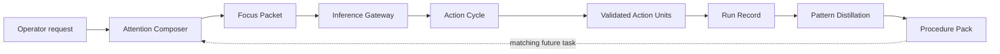

<p align="center">
  
</p>

<h1 align="center">Engram Runtime</h1>

<p align="center">
  <strong>A local-first AI execution runtime that remembers how successful work gets done.</strong>
</p>

<p align="center">
  Route work across local and frontier models, compose only the context each call needs,
  run validated actions, and turn repeated success into reusable procedure knowledge.
</p>

<p align="center">
  
  
  
  
</p>

---

## Why Engram exists

Powerful models are useful, but sending every task to the largest model wastes
money and attention. Smaller or local models cost less, but they should not be
forced to solve work that requires deeper reasoning. Repeated tasks create a
second problem: a normal agent pays again to rediscover context, tools, and the
sequence that already worked.

Engram Runtime separates those concerns from the model. It provides an open,
inspectable control plane that can:

- keep routine inference on the operator's machine;
- expose economy, balanced, and frontier routes when a hosted model is useful;
- retrieve only the memories, tools, and procedure cues relevant to this call;
- validate every requested action before execution;
- retain large outputs outside the active prompt;
- record evidence from each run; and
- distill successful action sequences into procedures that later runs can reuse.

The runtime is open source and local-first. Model inference is a replaceable
boundary: it can use Ollama locally, the OpenAI API, or an optional LiteLLM
bridge for other providers. Provider credentials remain in the local
environment and are never committed to the repository.

## The central idea

Engram does more than preserve a chat transcript. It preserves **execution
experience**.

On a first successful task, the runtime records the selected actions, their
validated inputs, outputs, and final outcome. That evidence can produce a
candidate **Procedure Pack**. When a matching task succeeds again, Engram adds
independent verification. Later runs can retrieve the compact procedure cue
instead of rebuilding the entire approach from raw history.



This is how Engram aims to spend fewer tokens over time without hiding the
reasoning behind the savings.

## What happens during a run

1. **Active Frame receives the request.** The current thread, workspace, and
   operator settings define the execution boundary.
2. **Attention Composer builds a Focus Packet.** It selects recent exchanges,
   relevant experience, matching procedures, and only the Action Units that
   may help.
3. **Inference Gateway resolves a model profile.** The current console exposes
   explicit local, economy, balanced, and frontier choices.
4. **Action Cycle executes within a Persistence Budget.** Calls are schema
   validated, unselected tools are rejected, repetition is bounded, and write
   or external actions require the Operator Gate.
5. **State Core records the evidence.** Messages, usage, action dispatches,
   outputs, failures, and completion state remain inspectable.
6. **Pattern Distillation learns from success.** A successful action sequence
   becomes a candidate procedure; a later independent success can verify it.

The current MVP lets the operator choose the model route. Automatic policy
routing can be added behind the same Inference Gateway without changing the
rest of the runtime.

## Model routes

| Profile | Default provider | Intended use | Default model |
| --- | --- | --- | --- |
| `local` | Ollama | Private, routine, and offline-capable work | `olmo-3:7b-instruct` |
| `economy` | OpenAI Responses API | Lightweight hosted reasoning | `gpt-5.6-luna` |
| `balanced` | OpenAI Responses API | General multi-step work | `gpt-5.6-terra` |
| `frontier` | OpenAI Responses API | Demanding planning and reasoning | `gpt-6-astra` |

Every model identifier is environment-configurable. The optional open-source
LiteLLM adapter can expose Claude, Gemini, hosted Llama, OpenRouter, and other
compatible providers through the same internal request, tool, and response
contracts.

## The Engram system

| Component | Responsibility |
| --- | --- |
| **Inference Gateway** | Normalizes local and hosted model providers. |
| **State Core** | Persists threads, runs, messages, records, and stored outputs transactionally. |
| **Signal Index** | Combines lexical and vector discovery with local refinement. |
| **Experience Ledger** | Preserves active, factual, historical, and procedural experience. |
| **Domain Lens** | Grounds work in project facts, conventions, schemas, and institutional knowledge. |
| **Capability Forge** | Registers validated actions and stores reusable procedures. |
| **Action Cycle** | Runs bounded reason-action-observation loops. |
| **Attention Composer** | Builds the smallest useful Focus Packet for one inference call. |
| **Runtime Console** | Makes model choice, context selection, actions, evidence, and savings visible. |

The canonical definitions live in
[`docs/engram-lexicon.md`](docs/engram-lexicon.md). Engram uses its own product
language while retaining the correct names for standards and external
technologies.

## Attention economy

Attention Composer compares each selected Focus Packet with an uncompressed
local baseline. When a matching Procedure Pack exists, it narrows recent
conversation, experience signals, and action schemas while retaining the
procedure cue.

In the verified local MVP, one representative repeated run changed from an
estimated **438 tokens to 259 tokens**, avoiding **179 tokens (41%)**, while the
selected action schemas fell from three to one. These are measured local
estimates for that run, not a universal savings claim. The evidence is recorded
in [`docs/verification.md`](docs/verification.md).

## Codex through MCP

Engram can run as a local [Model Context Protocol](https://modelcontextprotocol.io/)
server. In this mode, Codex remains the reasoning host and keeps the model the
operator selected. Engram contributes only a compact, project-scoped memory
packet and records validated outcomes for later work.

The committed [`.codex/config.toml`](.codex/config.toml) starts the server over
standard input/output for this repository. It exposes three bounded tools:

| Tool | Purpose |
| --- | --- |
| `runtime_status` | Report local storage readiness and scoped memory counts. |
| `recall_signals` | Return up to three concise signals relevant to one task. |
| `preserve_signal` | Store one evidence-backed fact, decision, constraint, outcome, correction, or failure. |

The bridge rejects likely credentials, caps input and output sizes, labels
writes for the host, and uses the isolated `codex-evaluation` workspace. Start
a new Codex task from this repository after changing MCP configuration so the
host can load the project server.

The reproducible evaluator runs the same read-only task against isolated
repository copies with the same model and reasoning effort:

```powershell
uv run engram-benchmark --mode both --model gpt-5.6-luna --reasoning low
```

In the first optimized five-task run, Engram reduced total input tokens by
5.7%, uncached input by 24.0%, output by 18.9%, elapsed inference time by 21.3%,
and repository tool calls by 25.0%. Expected-answer coverage increased from
14/15 to 15/15. The local memory seed took 12.151 seconds and is reported
separately. This is an initial single-run result rather than a universal
savings claim. See [`benchmarks/codex/latest-results.md`](benchmarks/codex/latest-results.md)
for the full table and limitations.

### Scientific evaluation track

The expanded evaluator defines a randomized, paired matrix across GPT-5.5,
GPT-5.6 Luna, Terra, Sol, and GPT-6 Astra. It holds model, effort, task,
frozen snapshot, non-Engram tools, and budget constant inside every Engram
OFF/ON pair, supports
checkpointed resume, and reports exact McNemar and paired bootstrap/sign-flip
statistics. Its five-repetition pilot contains 125 pairs and 250 runs.

```powershell
uv run engram-science plan
uv run engram-science run --max-pairs 1
uv run engram-science analyze
uv run engram-debate --help
```

The internal tasks are an instrumentation pilot. The official external track
starts with a pinned LongMemEval-V2 adapter and then adds execution, coding, and
tool-use suites. See
[`docs/scientific-benchmark.md`](docs/scientific-benchmark.md) and the
[`preregistration`](benchmarks/scientific/preregistration.md) for the claim
boundary, fixed hypotheses, metrics, exclusions, and stopping rule. The latest
five-model harness check is published separately as a clearly labeled
[`smoke test`](benchmarks/scientific/latest-smoke.md).
The matching [`blind jury report`](benchmarks/scientific/latest-debate.md)
keeps model critiques separate from the objective ON/OFF endpoint.

## Local stack

- Python 3.12 and FastAPI for the runtime service.
- PostgreSQL and pgvector for transactional state and vector discovery.
- Ollama and `nomic-embed-text:v1.5` for local inference and embeddings.
- FastEmbed for optional local result refinement.
- OpenAI Responses API for the hosted profiles.
- LiteLLM as an optional universal provider bridge.
- Plain HTML, CSS, and JavaScript for the crystalline Runtime Console.
- Inter Variable, distributed locally under the SIL Open Font License.

The control plane uses open-source components. Optional hosted models remain
subject to their provider's pricing, access rules, and model licenses.

## Quick start on Windows

### Requirements

- Python 3.12+
- [`uv`](https://docs.astral.sh/uv/)
- Docker Desktop, or Docker Engine inside WSL2
- Ollama for the default local route

### Install and start

```powershell
git clone https://github.com/Yixzus360/engram-runtime.git
cd engram-runtime
uv sync --all-groups
./scripts/up.ps1
. ./scripts/use-local-state.ps1
uv run engram migrate
./scripts/run.ps1
```

Open `http://127.0.0.1:8765`.

`scripts/up.ps1` uses Docker directly when available and falls back to the
Docker engine in WSL2. `scripts/use-local-state.ps1` selects the reachable
State Core address without persisting provider credentials.

### Configure models

Copy `.env.example` to `.env.local`, then set only the providers you intend to
use. Ollama can operate without a hosted API key.

```powershell
Copy-Item .env.example .env.local
```

```dotenv
ENGRAM_PROVIDER=ollama
ENGRAM_MODEL=olmo-3:7b-instruct
OPENAI_API_KEY=
```

Install the optional universal provider bridge when needed:

```powershell
uv sync --extra universal
```

## Safety and inspectability

- Every Action Unit has a JSON input contract and a declared risk level.
- The model can invoke only actions selected for the current Focus Packet.
- Read actions can run directly; write and external actions pass through the
  Operator Gate.
- Dispatch count, duration, and repeated identical calls are bounded.
- Large results are stored once and represented in context by an anchored
  preview and checksum.
- Candidate procedures are labeled as hypotheses until a distinct successful
  run verifies them.
- OpenAI requests use `store: false` in the native adapter.

## Repository map

| Path | What lives there |
| --- | --- |
| [`src/engram_runtime/`](src/engram_runtime/) | Runtime engine, provider boundary, memory, retrieval, action execution, and web service. |
| [`src/engram_runtime/static/`](src/engram_runtime/static/) | Crystalline Runtime Console, local font, favicon, and visual motion system. |
| [`src/engram_runtime/sql/`](src/engram_runtime/sql/) | Transactional State Core schema and pgvector indexes. |
| [`tests/`](tests/) | Behavioral checks for isolation, retrieval, learning, gating, routing, and token composition. |
| [`docs/`](docs/) | Architecture, vocabulary, visual contract, build stages, and verified evidence. |
| [`benchmarks/codex/`](benchmarks/codex/) | Reproducible Codex tasks, scoring terms, and the latest paired result. |
| [`benchmarks/scientific/`](benchmarks/scientific/) | Preregistered matrix, pinned external suites, prices, and statistical decision rules. |
| [`benchmarks/adapters/`](benchmarks/adapters/) | Bridges to official third-party benchmark harnesses. |
| [`.codex/config.toml`](.codex/config.toml) | Repository-scoped local MCP connection for Codex. |
| [`scripts/`](scripts/) | PowerShell lifecycle scripts for local Windows and WSL2 development. |
| [`compose.yaml`](compose.yaml) | Local PostgreSQL and pgvector service definition. |
| [`.env.example`](.env.example) | Safe configuration template without credentials. |
| [`pyproject.toml`](pyproject.toml) | Package identity, dependencies, entry point, and development tooling. |

## Current status

The nine-stage local MVP is complete and verified. It includes State Core,
Signal Index, Experience Ledger, Capability Forge, Action Cycle, Attention
Composer, provider profiles, procedure learning, and the Runtime Console.

The ninth stage adds a local MCP bridge, repository-scoped Codex configuration,
and a paired evaluation harness. The bridge does not replace the host model or
silently change its reasoning level.

Current scope:

- local, single-operator runtime;
- synchronous bounded execution;
- explicit model profile selection;
- native Ollama and OpenAI adapters;
- optional LiteLLM provider bridge; and
- no hosted account or remote authentication layer yet.

See [`docs/build-stages.md`](docs/build-stages.md) for delivery scope and
[`docs/verification.md`](docs/verification.md) for the latest test and live-run
record.

## Development principles

- Local operation is the default.
- Hosted inference is optional.
- Provider names do not leak into domain logic.
- Side effects pass through registered and validated Action Units.
- Durable procedures require execution evidence.
- Large outputs stay outside the active prompt until requested.
- The interface shows what the runtime selected and why.
- Product vocabulary and implementation remain independently authored.

## License

Engram Runtime is released under the [Apache License 2.0](LICENSE).
