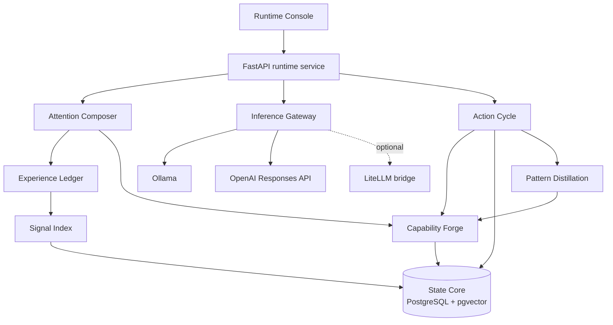

# Engram Runtime architecture

Engram is a local-first control plane around replaceable inference providers.
The runtime owns context selection, action safety, durable state, evidence, and
procedure learning. A model supplies inference; it does not own the system.

## System topology

All default services run on one workstation. PostgreSQL with pgvector provides
transactional storage and vector discovery. Ollama supplies local inference and
embeddings. The browser-based Runtime Console connects only to the local FastAPI
service.

## Boundaries

### Inference boundary

Inference Gateway exposes one internal request, tool, and response contract.
Native adapters implement Ollama and the OpenAI Responses API. The optional
LiteLLM adapter extends the same contract to additional providers. Domain
packages never depend on a provider SDK or provider-specific response shape.

The current `local`, `economy`, `balanced`, and `frontier` profiles are explicit
operator choices. Automatic routing is a future policy layer, not hidden
behavior in the MVP.

### State boundary

State Core owns transactions, workspace isolation, Run Records, and Stored
Outputs. Signal Index owns lexical and vector discovery. Experience Ledger adds
lifecycle meaning, retention, and supersession to retrieved records.

Large action results are anchored in State Core. The model receives a bounded
preview, identifier, byte count, and checksum instead of the entire payload.

### Capability boundary

Capability Forge registers Action Units with a JSON input contract, risk level,
and callable implementation. Attention Composer selects the allowed subset for
one Focus Packet. Action Cycle rejects any action the model requests outside
that subset.

Read actions can run directly. Write and external actions require an Operator
Gate decision. Dispatch count, elapsed time, and repeated identical calls are
bounded by the Persistence Budget.

## Execution path

1. Runtime Console submits an operator request and selected inference profile.
2. Attention Composer retrieves relevant conversation, experience, procedures,
   and Action Units.
3. The composed Focus Packet and action schemas cross the Inference Gateway.
4. Action Cycle validates and dispatches requested actions within its limits.
5. Every transition emits an ordered Run Record into State Core.
6. A successful action sequence can enter Pattern Distillation.
7. Runtime Console presents the outcome, evidence, usage, and procedure status.

## Durable experience

Capability Forge may create a candidate Procedure Pack after one successful
action sequence. A matching later run can retrieve that candidate as an
explicit hypothesis. A distinct successful run adds verification and promotes
the procedure to `verified`.

This evidence gate separates reusable operating knowledge from an unverified
model suggestion.

## Attention economy

Attention Composer compares each selected Focus Packet with an uncompressed
local baseline. When a relevant procedure exists, it keeps the procedure cue
and narrows recent exchanges, experience signals, and Action Units. Estimated
input size and avoided tokens are emitted as visible run evidence.

The estimate is provider-neutral and intentionally approximate. It explains a
selection decision; it is not presented as an invoice or guaranteed saving.

## Deployment scope

The MVP is a local single-operator runtime. It has no hosted account layer,
remote tenancy, distributed job worker, or production network perimeter. These
are deliberate scope boundaries rather than implicit security guarantees.
