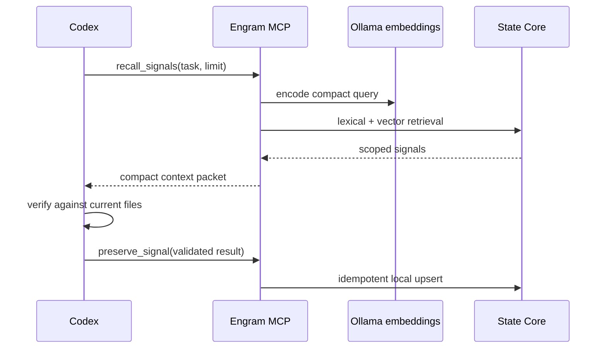

# Codex MCP bridge

The Engram MCP bridge lets Codex use local execution memory without moving
model selection into Engram. Codex remains the host. The model and reasoning
effort selected for the Codex task remain unchanged.

## Local data path



The server uses the official open-source Python MCP SDK and the `stdio`
transport. It opens no new HTTP port. PostgreSQL with pgvector stores the
signals, and Ollama creates embeddings on the same machine.

## Project connection

The repository includes [`.codex/config.toml`](../.codex/config.toml):

```toml
[mcp_servers.engram]
command = "uv"
args = ["run", "engram-mcp"]
cwd = "."
env = { ENGRAM_WORKSPACE_SLUG = "codex-evaluation" }
```

Run the State Core migration before opening a new Codex task:

```powershell
./scripts/up.ps1
. ./scripts/use-local-state.ps1
uv run engram migrate
```

Codex loads project MCP configuration when it starts a task in a trusted
repository. A task that was already running before the configuration changed
must be restarted or replaced by a new task.

## Tool contract

`recall_signals` returns at most three short signals and clips each content
field. The normal request uses one signal. `preserve_signal` requires a task,
evidence, success state, and one of six explicit kinds. Normalized duplicates
upsert instead of multiplying records. Content resembling an API key,
password, secret, or private key is rejected.

The server cannot browse arbitrary local files. Codex uses its own repository
tools to verify recalled claims before relying on them.

## Evaluation

The evaluator launches independent, ephemeral Codex sessions against isolated
repository copies. Baseline and Engram runs use the same model, reasoning
effort, task, and source snapshot. It captures Codex JSONL events and reports:

- input, cached input, uncached input, output, and reasoning tokens;
- elapsed time and tool calls;
- exit state and expected-answer coverage; and
- local memory seed time as a separate cost.

Run all five tasks:

```powershell
uv run engram-benchmark --mode both --model gpt-5.6-luna --reasoning low
```

Select one or more cases during development:

```powershell
uv run engram-benchmark --mode both --task-id procedure-verification
```

Outputs are written under ignored `artifacts/benchmarks/<timestamp>/`. Commit a
sanitized result only after checking the raw events for failed tool calls and
absolute local paths.
